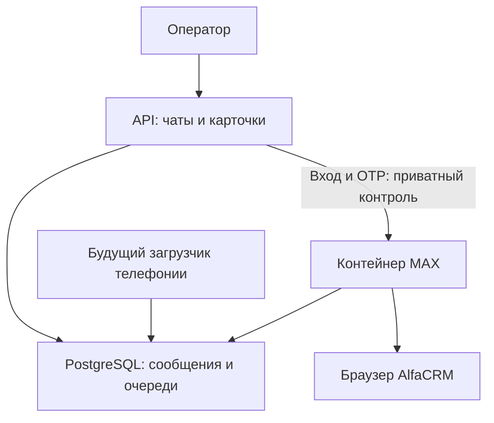

# Отдельный контейнер MAX через AlfaCRM

## Граница

`api` хранит публичные маршруты, чаты, карточки, задачи, ИИ, CRM-справочник,
webhook/очереди MAX-бота. `max-worker` выполняет только нативный MAX через
браузер AlfaCRM: вход, OTP, восстановление сессии, историю и исходящие.
Единственная общая PostgreSQL остаётся на месте; новая БД и миграции не нужны.



Телефония на схеме — будущий адаптер, сейчас его нет. Он должен публиковать
нормализованные события через общий серверный слой/проектирование событий,
а не обращаться к браузеру MAX или самостоятельно править его таблицы очередей.
Общая БД на схеме обозначает общий контур хранения, не разрешение на произвольный SQL.

## Разделение выполнения

| Процесс | Роль | Задачи | Пул БД |
| --- | --- | --- | --- |
| API | `CM_RUNTIME_ROLE=api` | CRM, карточки, общий чат, ИИ, bot queues | 6 + 2 |
| MAX | `CM_RUNTIME_ROLE=max` | `alfa_max.history`, `alfa_max.outgoing` | 2 + 1 |
| Локальные тесты/прежний режим | `combined` | совместимость до явного перехода | 6 + 2 |

В API установлен `BrowserDisabled`: попытка случайно вызвать локальный
Playwright не запускает браузер. В worker нет публичных маршрутов чата,
авторизации приложения, ИИ или статики. Его единственный uvicorn-процесс
запускается через `center_messenger.max_worker:app --factory`.

Карточки и готовая история читаются из локальной БД независимо от доступности
MAX worker. Отправка по-прежнему сначала сохраняет команду в БД. Ошибка или
перезапуск worker не удаляют очередь, браузерную сессию или курсоры. По
неопределённому результату POST сохраняется прежнее правило: сверка с журналом,
без слепой повторной отправки. Входящие/изменения видны API через сохранённые
версии `chat_read_versions` и существующий SSE; общей памяти процессов не требуется.

Монитор истории читает уже сохраняемую активность из БД. In-memory monitor
остаётся у worker и не является единственным источником прогресса.

## Внутренний контроль

Только ручные `connect` и `verify` перенаправляются из API в
`http://max-worker:8001`. Дестинация/операции не задаются пользователем.
Перед пересылкой API проверяет сессию, CSRF и право управления workspace;
worker повторно проверяет их штатным кодом. Заголовок
`X-CM-Max-Worker-Key` — дополнительный 256-битный секрет, а не замена
аутентификации оператора. Session/CSRF передаются только во внутренней сети.

Новый секрет `.secrets/max_worker_key` создаётся при подготовке: владелец UID
10001, mode 0400; ключ не печатается, не хранится в Git и не передаётся в URL.
Не подключаются HTTP-прокси из окружения, редиректы и автоматические повторы
управляющих POST. Неизвестный результат входа предлагается проверить чтением
статуса из БД. Отсутствующий worker/ключ не включает локальный fallback и
не мешает API создавать приложение и выдавать кэшированные чаты.

Worker не публикует порт хоста. У него нет Docker socket, bind mount исходников,
пароля владельца БД или bootstrap-token. Контейнер read-only, без capabilities,
с `no-new-privileges`, ограничениями CPU/RAM/PID и временной файловой системой.
Доступ к PostgreSQL — существующая runtime-роль `cm_app` с RLS. Это разделение
процессов и жизненного цикла, а не отдельная система tenant-прав или новая БД.

Readiness MAX требует БД, двух зарегистрированных шагов и живых потоков
планировщика. API readiness по-прежнему зависит от своей БД, а не от сети CRM.
Docker самостоятельно перезапускает завершившийся worker (`unless-stopped`);
неуспешный healthcheck сам по себе не перезапускает ещё работающий контейнер.

## Образы и обычные обновления

Первый проверенный образ получает дополнительный тег
`center-messenger:max-<SHA>`, закреплённый в серверном `CM_MAX_IMAGE`.
Тег записывается по проверенному image ID; другой image под тем же MAX-тегом
не перезаписывается. После перехода обычный деплой меняет только `api` и
никогда не выполняет `up max-worker` и не меняет `CM_MAX_IMAGE`.

Браузер и Chromium физически продолжают входить в общий шаблон образа:
в API они не выполняются. Уменьшение API-образа отдельным Dockerfile — иной
этап. Исходный репозиторий общий, однако новый API-код не заменяет файлы
уже работающего закреплённого образа MAX.

Обновление самого worker требует отдельной MAX-задачи, проверок, допуска,
проверенного нового image и управляемого изменения pin (порядок ниже). Смена схемы БД после
перехода блокируется обычным runner: нельзя автоматически оставить старый
worker несовместимым с новой схемой. Нужен отдельный парный план обновления.

## Обновление закреплённого worker без изменения схемы

`scripts/max_runtime_deploy.py --update-worker` **только подготавливает**
точный `max-runtime-update.json`; сам не запускает/не пересоздаёт контейнеры.
Выпуск выполняет прежний `ramessenger-local-build.service` под `.deploy.lock`.
Во время полного бэкапа тот же lock занят: дождаться окончания копирования,
а не обходить lock или прерывать бэкап.

```bash
python3 scripts/max_release_guard.py install --source "$PWD" --expected-policy <NEW_POLICY> --previous-policy <OLD_POLICY> --expected-live <LIVE_API_FULL_SHA>
python3 scripts/max_runtime_deploy.py --update-worker --source "$PWD" --sha <FULL_SHA> --expected-api <LIVE_API_IMAGE> --expected-max <PINNED_MAX_IMAGE> --expected-policy <NEW_POLICY>
systemctl start --no-block ramessenger-local-build.service
```

Подготовка проверяет точные SHA/policy, старые API/MAX, текущие container/image
ID, pin, завершённое разделение, неизменный Compose и ту же версию схемы.
Новая policy задаёт `worker_runtime_contract`. Если контракт работающего MAX
ещё старый, выпуск блокируется до явного плана обновления: обычный API-деплой
не может молча оставить исправленный код только в API, сохранив ошибочный worker.

После обязательных тестов и проверенного DB dump runner сохраняет прежние
`.env` и runtime metadata с хэшами, записывает recovery intent, закрепляет
проверенный image ID новым MAX tag, пересоздаёт только worker и проверяет его.
Затем штатно обновляет API, повторно проверяет MAX и атомарно публикует новый pin,
контракт и image ID. Успех — `MAX WORKER UPDATE COMPLETE` и `LOCAL DEPLOYED`.
Браузерные аренды, send intents и курсоры не сбрасываются; при неизвестном
результате POST действует сверка, а не повтор сообщения.

Откат восстанавливает оба прежних образа, `.env` и runtime metadata. БД не
восстанавливается из дампа и не откатывается: сообщения за это время сохраняются.
После прерывания следующий запуск сначала выполняет recovery. Если файл/образ
изменён другим процессом, recovery блокируется для разбора вместо перезаписи.
После неудачи нужна явная повторная подготовка; прежний rollback-архив остаётся.
После успеха обычные API-релизы снова не пересоздают MAX. Обновление схемы этим
механизмом по умолчанию запрещено. Явный парный план совместимости
для добавления настроек Новофона описан в [отдельной инструкции](novofon-settings-release.md).

Для роли `max` чтение истории и браузерный арбитраж включены независимо от
`CM_CRM_SYNC_WORKER=false`: этот флаг отключает общий справочник. Роль `api`
не участвует в native-арбитраже даже при включённых общих worker-флагах.

## Первый переход

Переход не включается одной публикацией Compose. Нужны новый закреплённый
guard bundle и явно подготовленный `max-runtime-transition.json` с точными
SHA, старым API image и хэшами старого/нового Compose. Подготовка не запускает
контейнеры и не меняет текущий Compose/API.

1. Проверить резервные копии. Зафиксировать текущие API image, policy hash,
   schema; проверить ресурсы VPS (минимум 3 GiB RAM всего и 1 GiB доступной памяти).
2. Получить ровно проверенный commit, установить его guard bundle с точными
   `--expected-policy`, `--previous-policy`, `--expected-live`.
3. В этом же проверенном checkout выполнить:
   `python3 scripts/max_runtime_deploy.py --source "$PWD" --sha <SHA> --expected-api <текущий_API_image> --expected-policy <новый_policy_SHA256>`.
4. Опубликовать этот SHA в `main` атомарно, если он ещё не опубликован.
5. Запустить существующий `ramessenger-local-build.service`, желательно
   `systemctl start --no-block ...`, а ход работы смотреть через `journalctl`.

Установщик задаёт каталогам нового guard bundle права `0755`, файлам кода и
тестов `0644`, индексу целостности `0600`. Это не зависит от `umask` root-shell:
тестовый контейнер с UID 10001 должен читать подключённый `tests/`. Приватные
родительские каталоги сервера, секреты и `umask` оператора не меняются.
При `Permission denied` до запуска тестов API ещё не переключён: установить
исправленный bundle и заново подготовить переход для точного нового SHA.

Единственный deploy owner под `.deploy.lock`:

- Проверяет точные файлы/план; при изменившемся `main` не продвигает старую сборку.
- Собирает образ, выполняет прежние MAX-проверки, тесты границ контейнера и
  unit-тесты перехода/отката. Контейнерные тесты используют тестовую БД.
- Создаёт и проверяет pg_dump. Дополнительно сохраняет прежние Compose и
  `.env` с контрольными суммами в закрытый каталог rollback.
- Записывает журнал перехода до изменения конфигурации.
- Закрепляет MAX image, запускает только `max-worker` и проверяет readiness.
- Штатным API promoter переключает API на роль `api`, проверяет обе стороны
  и только затем пишет `MAX RUNTIME SPLIT COMPLETE` и `LOCAL DEPLOYED`.

Короткое перекрытие старого и нового обработчиков ограничено существующими
арендами PostgreSQL: два процесса не получают право одновременно выполнять
одну браузерную операцию. Незавершённая старая операция заканчивается или
восстанавливается по сохранённой аренде. Во время перехода возможна задержка
очереди до истечения её срока; lock и send-intent ради ускорения не удаляются.

## Откат и прерывание

При ошибке восстанавливаются прежние Compose, `.env` и API image. Снимается
только созданный этой процедурой MAX container с проверенным image ID и
project label. PostgreSQL не останавливается и дамп автоматически не
восстанавливается: новые сообщения, записанные за время перехода, сохраняются.

Журнал `phase=promoting` позволяет следующему запуску сначала восстановить
неоконченный переход. При постороннем изменении конфигурации восстановление
блокируется для предметного разбора, а чужие изменения не затираются.
Повтор после неудачного перехода — повторная явная подготовка того же SHA;
прежний rollback-архив сохраняется, новый получает отдельный каталог.

Проверить после включения:

```bash
docker inspect --format '{{.Config.Image}} {{.State.Health.Status}}' center-messenger-api-1 center-messenger-max-worker-1
curl -fsS http://127.0.0.1:8100/health/ready
journalctl -u ramessenger-local-build.service -n 100 --no-pager -o cat
```

Обычный онлайн-бэкап трёх контейнеров и read-only аудит описаны в
[отдельной инструкции](full-backup-split.md): `scripts/full_backup_split.py`.
В копию входят оба runtime image, Compose, `.env`, control secret, connection
master key, DB dump/roles и весь внешний guard. Старый helper для API+DB не
использовать после разделения. Бэкап, созданный до перехода, остаётся копией
прежнего режима. Подготовка нового скрипта не означает, что его бэкап уже
создан на VPS: завершение подтверждает `BACKUP_COMPLETE` с проверкой восстановления.

## Телефония и будущие каналы

Нормализованный текст звонка/аудиоссылка смогут поступать в общий серверный
слой и общую ленту без обращения к MAX-контейнеру. Нужны устойчивый source ID
звонка, нормализация телефона и явные связи с CRM ID; несколько учеников
одного родителя сохраняются отдельными карточками. Один звонок не должен
становиться несколькими независимыми исходными записями.

VK, OK и Telegram по-прежнему планируются отдельными вкладками/коннекторами.
При необходимости общая история конкретного клиента строится по явным связям,
с сохранением канала каждой записи. Автоматического глобального общего чата нет.
Сейчас загрузчики телефонии, расшифровка, аудиоплеер и новые каналы не внедряются.
